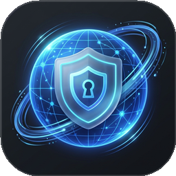
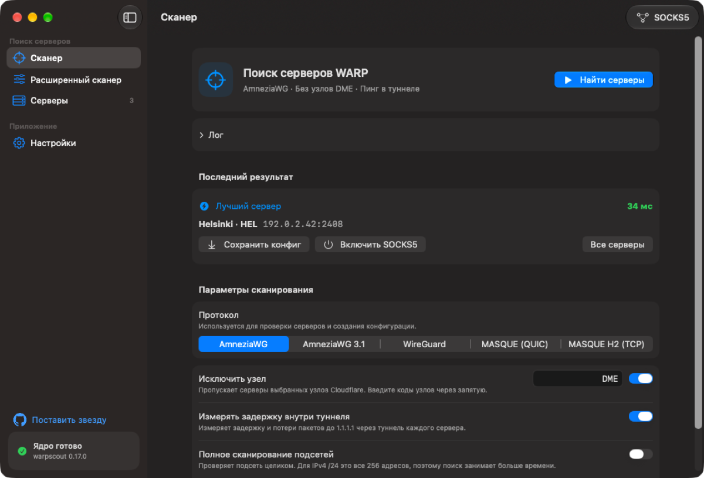
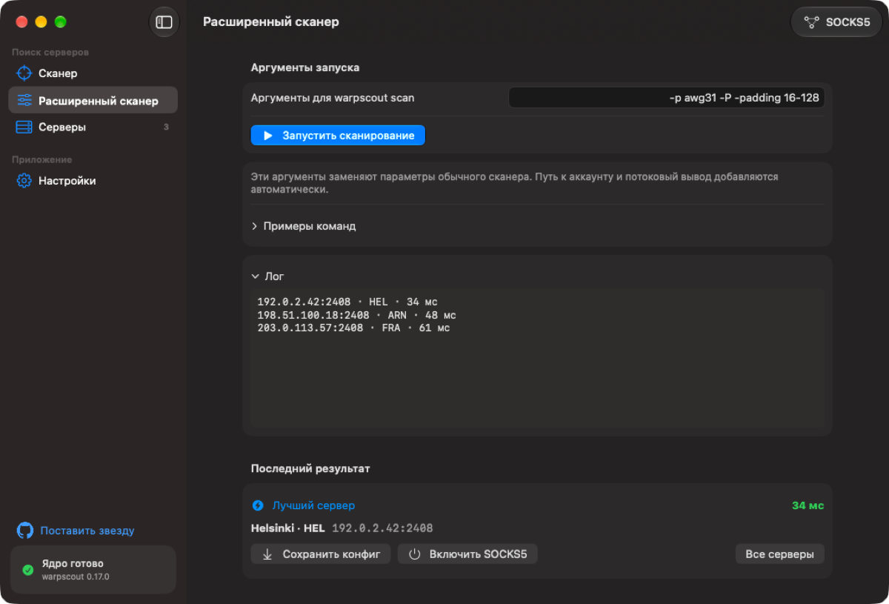
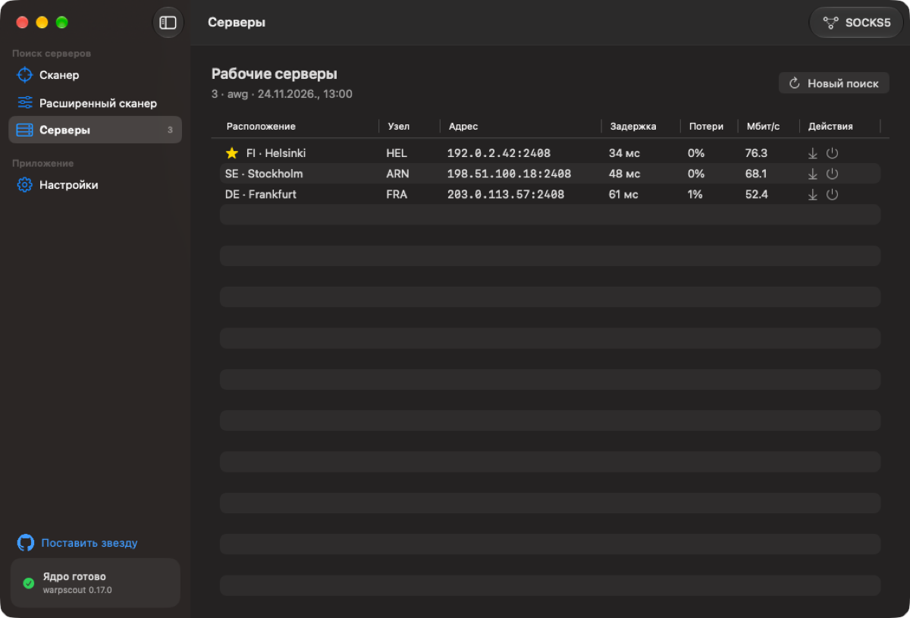
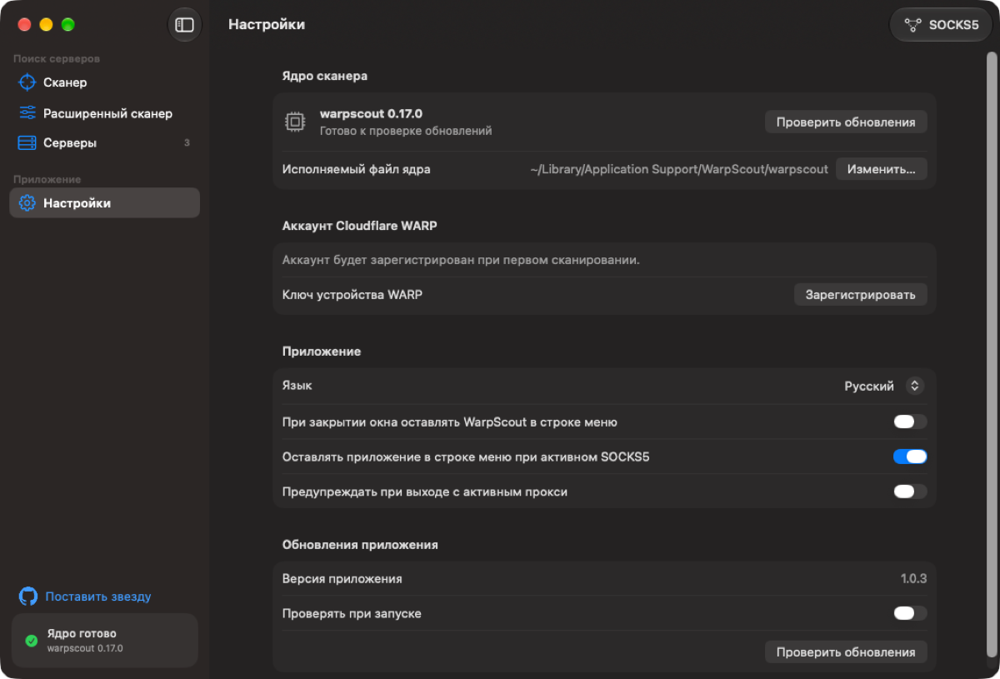

<div align="center">


<h1>WarpScout для macOS</h1>
<p>Нативный клиент для поиска рабочих серверов WARP® на Apple Silicon и Intel.</p>
<p>
  <a href="https://github.com/HattabbI4/warpscout-gui-macos/releases/latest"></a>
  <a href="https://github.com/HattabbI4/warpscout-gui-macos/releases"></a>
  <a href="https://github.com/HattabbI4/warpscout-gui-macos/actions/workflows/release.yaml"></a>
  <a href="#установка"></a>
  <a href="LICENSE"></a>
</p>
<p><strong>Русский</strong> · <a href="README_EN.md">English</a></p>

</div>

**[Версия для Windows](https://github.com/HattabbI4/warpscout-gui)**

## Установка

1. Скачайте ZIP для своего Mac: **[Apple Silicon](https://github.com/HattabbI4/warpscout-gui-macos/releases/latest/download/WarpScout-macOS-arm64.zip)** или **[Intel](https://github.com/HattabbI4/warpscout-gui-macos/releases/latest/download/WarpScout-macOS-x86_64.zip)**. Требуется macOS 26 или новее. Тип процессора указан в меню  → «Об этом Mac».
2. Распакуйте ZIP, перенесите **WarpScout.app** в «Программы» и откройте его оттуда.
3. Если macOS не может проверить разработчика, откройте **Первый запуск — Start Here.html** рядом с приложением. Там есть ссылка на нужный раздел системных настроек и [инструкция Apple](https://support.apple.com/ru-ru/102445). Сборка имеет локальную подпись ad-hoc и не прошла нотарификацию Apple.

При первой установке выберите архив для своего Mac. При последующих обновлениях WarpScout выбирает архитектуру автоматически.

При первом запуске приложение автоматически скачает ядро для вашего процессора из [последнего стабильного релиза warpscout](https://github.com/vernette/warpscout/releases/latest) и установит его в `~/Library/Application Support/WarpScout/warpscout`. При сбое откройте «Настройки» и нажмите «Загрузить ядро» или выберите локальный исполняемый файл. 
При следующем запуске используется установленная копия. При первом поиске ядро зарегистрирует устройство WARP. 

## Возможности

- **Сканер.** AmneziaWG, AmneziaWG 3.1, WireGuard, MASQUE (QUIC) и MASQUE H2 (TCP). Можно исключить узлы, измерить задержку и потери в туннеле, проверить подсети целиком и замерить скорость.
- **Расширенный режим.** Введите аргументы `warpscout scan`, следите за прогрессом и логом. Для AWG 3.1 доступны padding и параметры рукопожатия.
- **Серверы.** Результаты появляются во время поиска. Скопируйте адрес нажатием, экспортируйте профиль `.conf` или `.json` либо запустите локальный SOCKS5 на `127.0.0.1:1080`. Работу прокси можно контролировать из строки меню.
- **Настройки.** Выбор и обновление ядра, регистрация или пересоздание ключа устройства, русский и английский интерфейс. 

## Скриншоты

| Сканер | Расширенный сканер |
| :---: | :---: |
| [](docs/screenshots/scanner-ru.png) | [](docs/screenshots/advanced-ru.png) |

| Рабочие серверы | Настройки |
| :---: | :---: |
| [](docs/screenshots/servers-ru.png) | [](docs/screenshots/settings-ru.png) |

На снимках — демонстрационные адреса и результаты.

## Сборка и тесты

Для сборки нужны macOS 26+ и Xcode или Command Line Tools с macOS SDK 26+. Для тестов релизных скриптов нужны Python 3 и OpenSSL 3 или новее в `PATH`. Сборка создаёт отдельные архивы arm64 и x86_64 и не требует скачивания ядра.

```sh
git clone https://github.com/HattabbI4/warpscout-gui-macos.git
cd warpscout-gui-macos
./scripts/build.sh
open dist/WarpScout.app
```

```sh
./scripts/test.sh
python3 -m unittest discover -s Tests -p 'test_*.py'
```

Тесты используют временную копию исходников и одноразовый ключ подписи. Для проверки окна приложения нужен графический сеанс. Дополнительный запуск `WARPSCOUT_LIVE_TEST=1 ./scripts/test.sh` регистрирует отдельное устройство у Cloudflare и проверяет пять протоколов в вашей сети. Файл тестового аккаунта удаляется по завершении.

## Данные и обратная связь

Аккаунт и последний результат находятся в `~/Library/Application Support/WarpScout/`. Файл аккаунта и экспортированные профили содержат закрытые ключи. К сообщению об ошибке достаточно приложить версии оболочки, ядра, macOS и шаги воспроизведения на тестовых данных. [Issues](https://github.com/HattabbI4/warpscout-gui-macos/issues) · [Закрытое сообщение об уязвимости](SECURITY.md)

## Credits
- [vernette/warpscout](https://github.com/vernette/warpscout) — CLI-ядро сканера WARP, генерация конфигов и локальный SOCKS5-прокси.

WarpScout — независимый проект. Cloudflare и WARP — товарные знаки Cloudflare, Inc.
