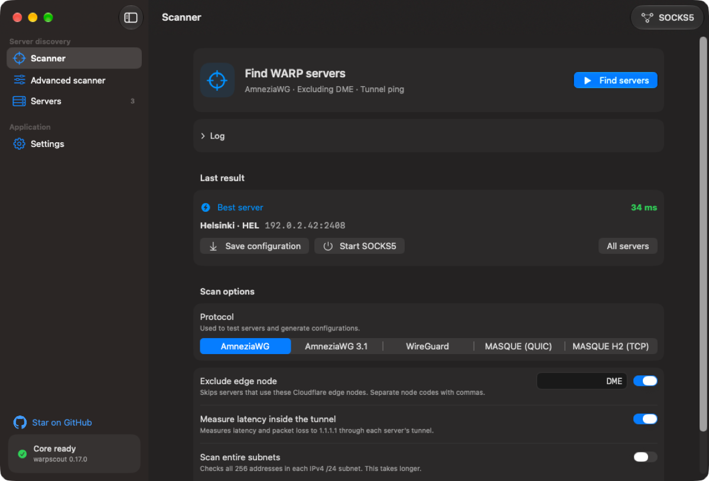
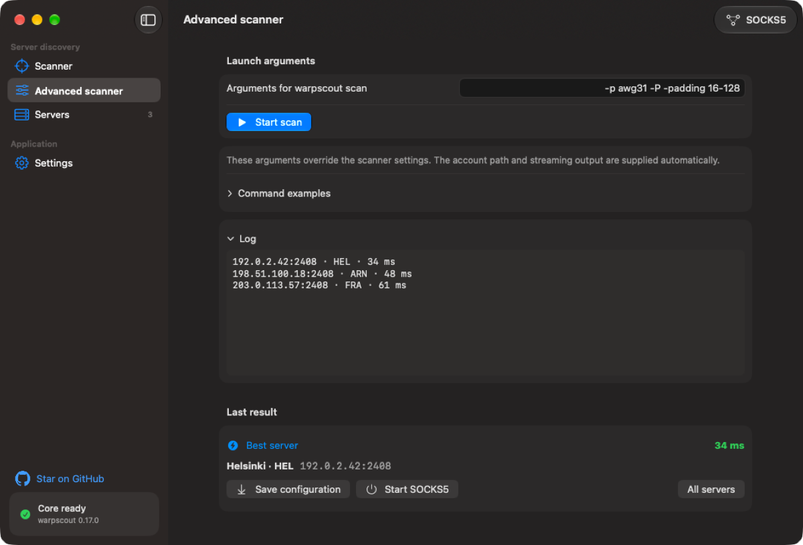
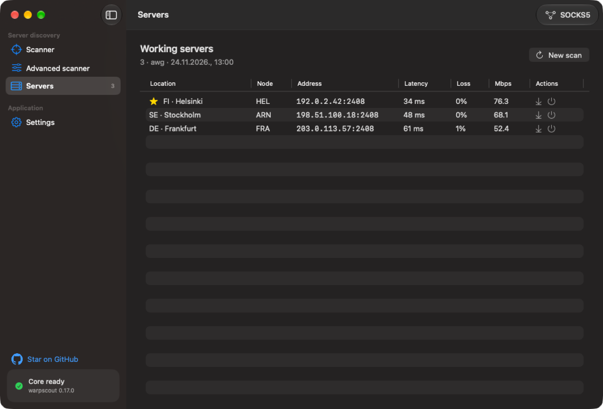
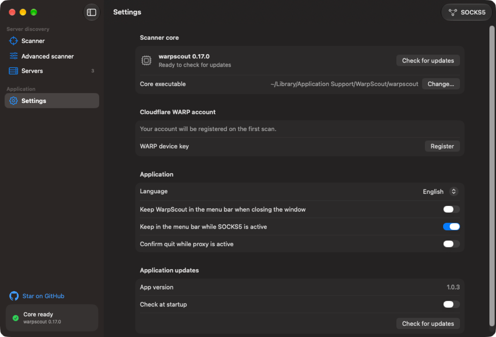

<div align="center">


<h1>WarpScout for macOS</h1>
<p>A native Mac app for finding working Cloudflare® WARP® endpoints on Apple Silicon and Intel.</p>
<p>
  <a href="https://github.com/HattabbI4/warpscout-gui-macos/releases/latest"></a>
  <a href="https://github.com/HattabbI4/warpscout-gui-macos/releases"></a>
  <a href="https://github.com/HattabbI4/warpscout-gui-macos/actions/workflows/ci.yaml"></a>
  <a href="#installation"></a>
  <a href="LICENSE"></a>
</p>
<p><a href="README.md">Русский</a> · <strong>English</strong></p>

</div>

## Installation

1. Download the ZIP for your Mac: **[Apple Silicon](https://github.com/HattabbI4/warpscout-gui-macos/releases/latest/download/WarpScout-macOS-arm64.zip)** or **[Intel](https://github.com/HattabbI4/warpscout-gui-macos/releases/latest/download/WarpScout-macOS-x86_64.zip)**. Requires macOS 26 or later. Check your chip or processor under  → About This Mac.
2. Unzip it, drag **WarpScout.app** into Applications and open it from there.
3. If macOS cannot verify the developer, open **Первый запуск — Start Here.html** next to the app and select **English**. It links to the relevant System Settings pane and [Apple’s first-launch instructions](https://support.apple.com/en-us/102445). This build is ad-hoc signed and has not been notarized by Apple.

Choose the archive for your Mac on first install. WarpScout selects the matching architecture automatically for subsequent updates.

On first launch the app downloads the core for your processor from the [latest stable warpscout release](https://github.com/vernette/warpscout/releases/latest), verifies its size, SHA-256 and version, and installs it at `~/Library/Application Support/WarpScout/warpscout`. First-time setup requires internet access. If it fails, open Settings and choose **Download core**, or select a local executable. Subsequent launches reuse the installed copy. The core registers a WARP device on the first scan. The standard scanner excludes DME by default. If there are no results and Moscow nodes are acceptable, turn off **Exclude edge node** and scan again. For core version 0.17.0, see the [security assessment](docs/release-readiness.md).

## Features

- **Scanner.** Test AmneziaWG, AmneziaWG 3.1, WireGuard, MASQUE (QUIC) and MASQUE H2 (TCP). Filter edge nodes, measure tunnel latency and packet loss, scan whole subnets and test download speed.
- **Advanced scanner.** Enter `warpscout scan` arguments and follow progress in the live log. AWG 3.1 supports padding and handshake settings.
- **Servers.** Results appear as the scan runs. Click an address to copy it, export a `.conf` or `.json` profile, or start a local SOCKS5 proxy at `127.0.0.1:1080`. The menu bar provides proxy controls.
- **Settings.** Select or update the core, register a device or regenerate its key, and switch between Russian and English. The app verifies Ed25519 signatures for upgrades and rollbacks.

## Screenshots

| Scanner | Advanced scanner |
| :---: | :---: |
| [](docs/screenshots/scanner-en.png) | [](docs/screenshots/advanced-en.png) |

| Working servers | Settings |
| :---: | :---: |
| [](docs/screenshots/servers-en.png) | [](docs/screenshots/settings-en.png) |

The screenshots use example endpoints and measurements.

## Build and test

Use macOS 26 or later and Xcode or Command Line Tools with macOS SDK 26+. The release script tests use Python 3 and OpenSSL 3 or later on `PATH`. Building the arm64 and x86_64 archives does not require downloading the core.

```sh
git clone https://github.com/HattabbI4/warpscout-gui-macos.git
cd warpscout-gui-macos
./scripts/build.sh
open dist/WarpScout.app
```

```sh
./scripts/test.sh
python3 -m unittest discover -s Tests -p 'test_*.py'
```

Tests use a temporary source tree and a disposable signing key. The window test requires a graphical login session. To register a separate Cloudflare device and check all five protocols on your network, run `WARPSCOUT_LIVE_TEST=1 ./scripts/test.sh`. The local test account file is removed afterwards.

## Data and feedback

The account and last scan are stored in `~/Library/Application Support/WarpScout/`. Account files and exported profiles contain private keys. When reporting a bug, include the app, core and macOS versions and steps to reproduce with test data. [Issues](https://github.com/HattabbI4/warpscout-gui-macos/issues) · [Private security reports](SECURITY.md) · [Release instructions](docs/releases.md)

## License and credits

Copyright **HattabbI4**. The GUI is available under the [MIT license](LICENSE). Its interface is adapted from [WarpScout GUI for Windows](https://github.com/HattabbI4/warpscout-gui). Scanning is powered by [vernette/warpscout](https://github.com/vernette/warpscout). The core has its [own license](https://github.com/vernette/warpscout/blob/master/LICENSE).

WarpScout is an independent project. Cloudflare and WARP are trademarks of Cloudflare, Inc.
